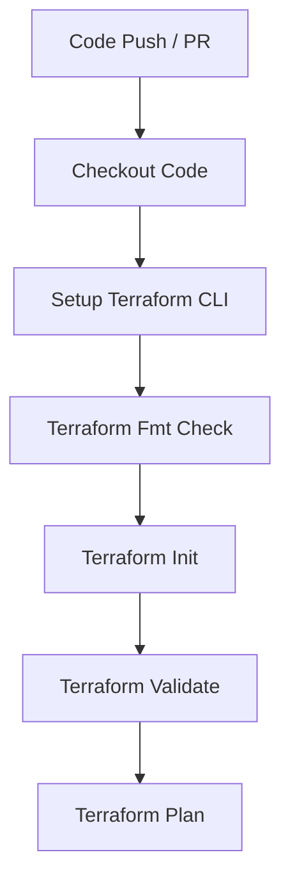

# AWS Infrastructure Provisioning with Terraform & GitHub Actions CI Pipeline

[](https://github.com)

This repository serves as a practical implementation of DevOps and Infrastructure as Code (IaC) principles. It demonstrates a production-ready Continuous Integration (CI) pipeline that automates the linting, validation, and planning phases of AWS cloud infrastructure architectures.

## 🏗️ Architecture Overview

The repository provisions a baseline, highly available network infrastructure architecture on Amazon Web Services (AWS):
*   **Virtual Private Cloud (VPC):** Custom network layout isolation with DNS hostnames enabled.
*   **Public Subnet:** Positioned in `us-east-1a` to support front-facing workloads, load balancers, or public endpoints.
*   **Resource Tagging Strategy:** Strict environment standardization tracking properties (`Name`, `Environment`, `ManagedBy`).

## 🚀 CI/CD Pipeline Automation Mechanics

The workflow is driven entirely by **GitHub Actions** (`.github/workflows/terraform.yml`), triggered dynamically on every `push` or `pull_request` targeting the `main` branch. 

The execution steps mirror enterprise-grade compliance checks before any code reaches production:



1.  **Code Checkout:** Injects the current branch state into the ephemeral runner workspace.
2.  **Deterministic CLI Execution:** Locks the operational runner environment to Terraform version `1.6.0` to ensure infrastructure alignment across team deployments.
3.  **Canonical Formatting (`terraform fmt`):** Performs a structural evaluation of compliance style syntax formatting. If any layout violates canonical conventions, the pipeline fails early.
4.  **Local State Initialization (`terraform init`):** Executes initialization with `-backend=false` configurations. This allows structural validation without demanding active remote state locking (e.g., S3/DynamoDB backends), making testing fast and decentralized.
5.  **Syntactical Validation (`terraform validate`):** Audits attributes, missing variables, or arguments across all active provider definition manifests (`.tf` files).
6.  **Dry Run Execution Planning (`terraform plan`):** Computes and renders structural execution configurations to map potential configuration drifted changes accurately.

## 🛠️ Local System Development Guide

### Prerequisites
*   [Terraform CLI](https://hashicorp.com) (>= 1.6.0)
*   [Git](https://git-scm.com) Installed

### Execution Sequence
To test the pipeline flow locally on your machine, clone the repository and run:

```bash
# Clone repository
git clone https://github.com
cd devops

# Format evaluation
terraform fmt -check

# Local initialization 
terraform init -backend=false

# Configuration syntax check
terraform validate

# Infrastructure drift generation simulation
terraform plan
```

## 🧠 Applied Engineering Best Practices

*   **Fail-Fast Design:** Format testing and semantic checks run before computing heavy infrastructure generation states.
*   **Immutable Pipeline Environments:** Leverages validated open-source marketplace standard action modules (`actions/checkout@v4`, `hashicorp/setup-terraform@v3`).
*   **Declarative Infrastructure Lifecycle:** Decoupled resource configurations using segregated mapping matrices (`provider.tf`, `main.tf`).
